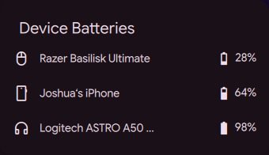

# Device Batteries

A [DankMaterialShell](https://github.com/AvengeMedia/DankMaterialShell) plugin
that shows the battery levels of all your wireless peripherals in one place.

DMS's own battery popout already lists Bluetooth peripherals that UPower knows.
This plugin adds what UPower cannot see – Razer devices (OpenRazer), USB
wireless headsets (HeadsetControl), the iPhone via BlueFerry and AirPods (left, right, case) via the
BlueFerry AirPods plugin – plus a bar pill for the lowest battery and
a low-battery warning. Other registry plugins cover a single device (one mouse
model, controllers, ZMK keyboards, a phone). It is meant for external hardware
only; the laptop battery has its own DMS widget.




- **Bar pill** shows the device with the lowest battery (icon + percent),
  orange at or below the warning level, red at 10 % or less, accent color
  while charging; hidden when no device reports a battery
- **Popout** lists every device with its level
- **Low battery warning**: one desktop notification per device, re-armed after
  charging
- **Setup hints**: if a Razer device is plugged in but the OpenRazer kernel
  driver is not bound (e.g. after a kernel update without a module rebuild), or
  the driver is there but `openrazer-daemon` does not answer, the popout says so
  and one notification is sent – instead of the device silently missing

## Sources

| Source | Devices | Needs |
|---|---|---|
| UPower | phones (iPhone/Android over Bluetooth), Bluetooth mice, keyboards, headphones, controllers | `upower` (already used by DMS) |
| [OpenRazer](https://openrazer.github.io/) | Razer wireless mice, keyboards, headsets | `openrazer-daemon` running |
| [HeadsetControl](https://github.com/Sapd/HeadsetControl) | USB wireless headsets (Logitech/Astro, SteelSeries, HyperX, Corsair, …) | `headsetcontrol` ≥ 4.2 for the Astro A50 Gen 5 |
| [BlueFerry](https://github.com/erikwb/blueferry) | iPhone over Bluetooth (BlueZ does not hand its battery to UPower) | `blueferry` daemon running |
| [blueferry-plugin-airpods](https://github.com/joshii-h/blueferry-plugin-airpods) | AirPods and Beats: left, right and case (AirPods Max: one level), from their Bluetooth adverts, also when they are paired with the iPhone only | the BlueFerry plugin installed and enabled |

UPower devices update live. OpenRazer, HeadsetControl, BlueFerry and the AirPods plugin are read by the
bundled helper `device-batteries.py`, which keeps running and re-reads at once
when a device is plugged in or docked (udev, needs `pyudev`), otherwise at the
configured interval. A plugin daemon runs the helper and the warnings exactly
once; the bar widgets on all monitors only display the shared result. Every
source is optional – whatever is not installed is skipped. A sleeping wireless
mouse (reporting 0 %) is left out until it wakes up. BlueFerry has its own
low-battery warning for the iPhone; while it is on, this plugin does not warn a
second time. AirPods levels come in 10 % steps; they are left out once the
AirPods have been silent for 10 minutes (closed case, out of range). AirPods
connected to this computer may also appear once through UPower (one combined
level). The helper needs `dbus-python` for BlueFerry and the AirPods plugin and
`pyudev` for instant updates.

## Installation

```sh
cd ~/.config/dms/plugins
git clone https://github.com/joshii-h/dms-device-batteries deviceBatteries
```

Requires DMS 2.0 or newer. Then enable **Device Batteries** in DMS Settings → Plugins and add it to a bar
section in Settings → DankBar Layout.

## Settings

| Setting | Default |
|---|---|
| Low battery warning | 20 % |
| Desktop notification (`dms notify`) | on |
| Refresh interval for OpenRazer/HeadsetControl/BlueFerry/AirPods (plug-in events update at once) | 1 minute |

## Translations

English and German (`translations/de.json`). Contributions welcome.

## License

MIT
